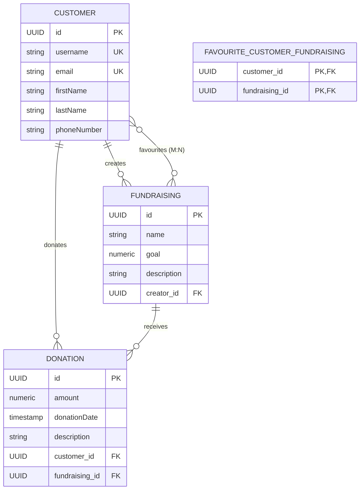
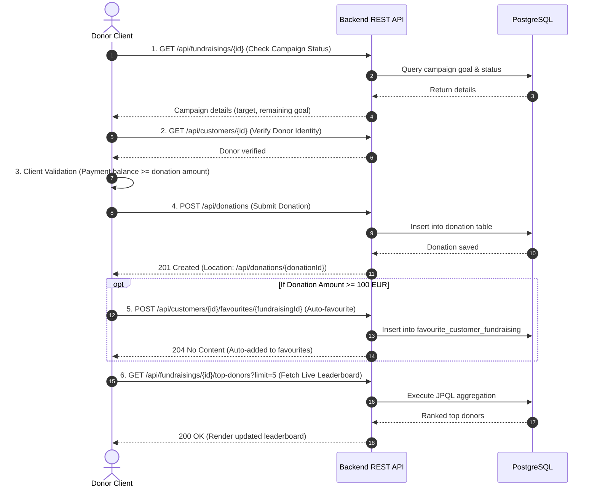

# 🌟 Fundraising Platform

[](https://openjdk.org/)
[](https://spring.io/projects/spring-boot)
[](https://www.postgresql.org/)
[](https://www.docker.com/)
[](https://swagger.io/)
[](https://opensource.org/licenses/MIT)

A modern, high-performance platform powering charitable fundraising and crowdfunding campaigns. Engineered with **Spring Boot**, **Spring Data JPA**, **Hibernate**, and **PostgreSQL**, adhering to Clean Architecture, Domain-Driven Design (DDD), and strict RESTful design principles.

---

## 📑 Table of Contents

- [Architectural Overview](#-architectural-overview)
- [Data Model & Database Schema](#-data-model--database-schema)
- [Real-Time Analytics & Aggregation](#-real-time-analytics--aggregation)
- [Core Business Workflows](#-core-business-workflows)
- [REST API Specification](#-rest-api-specification)
- [Automated Testing Strategy](#-automated-testing-strategy)
- [Quick Start & Local Deployment](#-quick-start--local-deployment)
- [Architecture & Feature Highlights](#-architecture--feature-highlights)

---

## 🏛️ Architectural Overview

The application is structured following a **Three-Tier Layered Architecture** with strict layer encapsulation:

```
         [ Web / Mobile Clients / Adminer ]
                         │
                         ▼  (JSON / HTTP)
 ┌─────────────────────────────────────────────────────────┐
 │               Presentation Layer (REST)                 │
 │  - CustomerController, FundraisingController,           │
 │    DonationController                                   │
 │  - OpenAPI 3.0 / Swagger Annotations & Location Headers │
 └─────────────────────────┬───────────────────────────────┘
                           │  (DTO Records: Request / Response)
                           ▼
 ┌─────────────────────────────────────────────────────────┐
 │             Application Logic Layer (Services)          │
 │  - CustomerService, FundraisingService,                 │
 │    DonationService, FavouriteService                    │
 │  - Transaction boundaries, Domain Validations,          │
 │    Cross-Service Orchestration, Clean Entity Mappers    │
 └─────────────────────────┬───────────────────────────────┘
                           │  (Domain JPA Entities)
                           ▼
 ┌─────────────────────────────────────────────────────────┐
 │               Persistence Layer (Data)                  │
 │  - CustomerRepository, FundraisingRepository,           │
 │    DonationRepository                                   │
 │  - Spring Data JPA, Hibernate ORM, Custom JPQL Queries  │
 └─────────────────────────┬───────────────────────────────┘
                           │  (SQL / JDBC)
                           ▼
                 [ PostgreSQL DB Server ]
```

### Key Engineering Patterns
- **Layered Architecture & Separation of Concerns**: Controllers communicate strictly via Service interfaces, preventing HTTP layer logic from leaking into domain logic.
- **Domain Service Collaboration**: Services encapsulate domain rules and coordinate cross-entity workflows (e.g., verifying donor accounts and campaign validity before processing a donation) while delegating database access to their respective Repositories.
- **DTO Isolation**: Database entities are completely segregated from API consumers using immutable Java `record` classes (`*RequestDto` and `*ResponseDto`).
- **Standardized Error Handling**: Centralized exception handler (`GlobalExceptionHandler`) emitting **RFC 7807 Problem Details** for unified, client-friendly error reporting.
- **RESTful Compliance**: HTTP POST endpoints return `201 Created` with a fully qualified `Location` header pointing to newly minted resources.

---

## 🗄️ Data Model & Database Schema

The domain model consists of **3 domain entities** with **UUID** primary keys and **1 Many-to-Many association**, yielding exactly **4 relational database tables**:

1. `customer` — user profiles for campaign creators and donors.
2. `fundraising` — charitable fundraising campaigns with target goals and descriptions.
3. `donation` — financial contributions linked to donor customers and targeted campaigns.
4. `favourite_customer_fundraising` — join table managing customer-favourited campaigns (M:N).

### Entity Relationship Diagram (ERD)



---

## ⚡ Real-Time Analytics & Aggregation

To provide real-time campaign leaderboard analytics, the platform utilizes database-level aggregation via **JPQL**:

### Business Goal
**"Retrieve the Top-N most generous donors for a given fundraising campaign, ordered by their total accumulated donation amount."**

### Implementation Details
- **Location**: [`DonationRepository.java`](file:///app/src/main/java/io/github/listerstellar/fundraising/repository/DonationRepository.java)
- **Endpoint**: `GET /api/fundraisings/{id}/top-donors?limit=5`
- **JPQL Query**:
```java
@Query("""
    SELECT new io.github.listerstellar.fundraising.dto.TopDonorDto(
        d.customer.id,
        d.customer.username,
        d.customer.firstName,
        d.customer.lastName,
        SUM(d.amount)
    )
    FROM Donation d
    WHERE d.fundraising.id = :fundraisingId
    GROUP BY d.customer.id, d.customer.username, d.customer.firstName, d.customer.lastName
    ORDER BY SUM(d.amount) DESC
""")
List<TopDonorDto> findTopDonorsByFundraisingId(@Param("fundraisingId") UUID fundraisingId, Pageable pageable);
```

### Highlights:
- ✅ **Database-Level Execution**: Aggregations are evaluated directly inside the database engine, avoiding in-memory stream filtering.
- ✅ **Multi-entity JOIN**: Joins `Donation` with `Customer` and `Fundraising`.
- ✅ **Aggregation (`SUM`)**: Computes total contributions across multiple donations made by the same user.
- ✅ **Grouping (`GROUP BY`)**: Groups by individual customer identity.
- ✅ **Parameterized & Ordered**: Accepts campaign ID parameter and orders by calculated sum descending (`ORDER BY SUM(d.amount) DESC`).
- ✅ **Type-Safe DTO Projection**: Directly instantiates `TopDonorDto` within the JPQL projection.

---

## 🔄 Core Business Workflows

The platform supports a comprehensive **Multi-Step Donation & Loyalty Workflow** designed for frontend clients (Web / Mobile / Desktop):



1. **Step 1: Campaign Validation** — Client verifies that the campaign exists and computes progress toward the goal.
2. **Step 2: Donor Authentication & Validation** — Client verifies the donor's profile and active account.
3. **Step 3: Contribution Creation** — Dispatches `POST /api/donations`, verifying `201 Created` and inspecting `Location`.
4. **Step 4: Loyalty Auto-Favouriting Rule** — If the contribution exceeds a milestone threshold (e.g., $\ge$ 100 EUR), the client automatically links the campaign to favourites (`POST /api/customers/{id}/favourites/{fundraisingId}`).
5. **Step 5: Dynamic Leaderboard Refresh** — Requests `GET /api/fundraisings/{id}/top-donors` to update the real-time campaign leaderboard.

---

## 📡 REST API Specification

Interactive Swagger UI documentation is available at:
👉 **`http://localhost:8080/swagger-ui.html`**  
Machine-readable OpenAPI JSON spec:  
👉 **`http://localhost:8080/api-docs`**

### Summary of Endpoints

| Resource | Method | Path | Description | Success Status |
|---|---|---|---|---|
| **Customers** | `GET` | `/api/customers` | List all registered customers | `200 OK` |
| | `GET` | `/api/customers/{id}` | Get customer by UUID | `200 OK` |
| | `GET` | `/api/customers/search` | Search by `?username=` or `?email=` | `200 OK` |
| | `POST` | `/api/customers` | Register customer (sets `Location` header) | `201 Created` |
| | `PUT` | `/api/customers/{id}` | Full profile update | `200 OK` |
| | `PATCH` | `/api/customers/{id}` | Partial profile update | `200 OK` |
| | `DELETE` | `/api/customers/{id}` | Delete customer | `204 No Content` |
| **Favourites (M:N)** | `GET` | `/api/customers/{id}/favourites` | Get customer's favourited campaigns | `200 OK` |
| | `POST` | `/api/customers/{id}/favourites/{fundraisingId}` | Add campaign to favourites | `204 No Content` |
| | `DELETE`| `/api/customers/{id}/favourites/{fundraisingId}` | Remove campaign from favourites | `204 No Content` |
| **Fundraisings** | `GET` | `/api/fundraisings` | List all fundraising campaigns | `200 OK` |
| | `GET` | `/api/fundraisings/{id}` | Get campaign by UUID | `200 OK` |
| | `POST` | `/api/fundraisings` | Create campaign (sets `Location` header) | `201 Created` |
| | `PUT` | `/api/fundraisings/{id}` | Full update of campaign | `200 OK` |
| | `PATCH` | `/api/fundraisings/{id}` | Partial update of campaign | `200 OK` |
| | `DELETE` | `/api/fundraisings/{id}` | Delete campaign | `204 No Content` |
| | `GET` | `/api/fundraisings/{id}/favoured` | Get users who favourited campaign | `200 OK` |
| **Analytics** | `GET` | `/api/fundraisings/{id}/top-donors` | Top-N donors ranked by total sum | `200 OK` |
| **Donations** | `GET` | `/api/donations` | List donations (`?customerId=`, `?fundraisingId=`) | `200 OK` |
| | `GET` | `/api/donations/{id}` | Get donation by UUID | `200 OK` |
| | `POST` | `/api/donations` | Submit donation (sets `Location` header) | `201 Created` |
| | `PUT` | `/api/donations/{id}` | Full update of donation | `200 OK` |
| | `PATCH` | `/api/donations/{id}` | Partial update of donation | `200 OK` |
| | `DELETE` | `/api/donations/{id}` | Delete donation | `204 No Content` |

---

## 🧪 Automated Testing Strategy

The test suite covers the entire system across **3 distinct architectural tiers** using JUnit 5, Mockito, Spring Data JPA Test, and MockMvc:

1. **Unit Tests (Service Layer in Isolation)**:
   - `CustomerServiceImplTest`, `FundraisingServiceImplTest`, `DonationServiceImplTest`, `FavouriteServiceImplTest`.
   - Built with Mockito (`@ExtendWith(MockitoExtension.class)`, `@Mock`, `@InjectMocks`).
   - Verifies isolated business logic, validations, and custom exception handling (`CustomerAlreadyExistsException`, `EntityNotFoundException`).
2. **Integration Tests (Persistence Layer)**:
   - `FundraisingRepositoryIntegrationTest`, `CustomerRepositoryIntegrationTest`, `DonationRepositoryIntegrationTest`.
   - Built with `@DataJpaTest` against an in-memory SQL database.
   - Validates entity mappings, foreign key constraints, Many-to-Many associations, and **executes the JPQL Top-5 donors query**.
3. **System Tests (End-to-End via HTTP API)**:
   - `CustomerControllerSystemTest`, `FundraisingControllerSystemTest`, `DonationControllerSystemTest`.
   - Built with `@SpringBootTest` and `@AutoConfigureMockMvc`.
   - Validates the entire pipeline: HTTP Requests $\to$ Filters $\to$ Controllers $\to$ Services $\to$ DB, verifying status codes (`201`, `200`, `204`, `400`, `404`, `409`) and `Location` headers.

### Executing Tests
```bash
cd app
./gradlew test
```

---

## 🚀 Quick Start & Local Deployment

### Option 1: Docker Compose (Recommended)
Spins up the Spring Boot app, PostgreSQL 16 database, and Adminer web GUI:

```bash
docker compose up --build
```

- **Backend API**: `http://localhost:8080`
- **Swagger UI**: `http://localhost:8080/swagger-ui.html`
- **OpenAPI Schema**: `http://localhost:8080/api-docs`
- **Adminer DB Manager**: `http://localhost:8081` (System: `PostgreSQL`, Server: `db`, Username: `admin`, Password: `admin`, Database: `fundraising_db`)

### Option 2: Local Gradle Run
Make sure PostgreSQL is running on port 5432:

```bash
cd app
./gradlew bootRun
```

---

## 🏆 Architecture & Feature Highlights

| Capability / Feature | Status | Engineering Implementation |
|---|:---:|---|
| **3 Domain Entities & CRUD** | ✅ | `Customer`, `Fundraising`, `Donation` with full CRUD operations |
| **Many-to-Many Relationship (M:N)** | ✅ | `Customer` $\leftrightarrow$ `Fundraising` via `favourite_customer_fundraising` |
| **4 Database Tables** | ✅ | `customer`, `fundraising`, `donation`, `favourite_customer_fundraising` |
| **Persistent Relational Database** | ✅ | PostgreSQL 16 production-grade server in Docker Compose |
| **Real-Time Aggregation (JPQL)** | ✅ | `findTopDonorsByFundraisingId` (JOIN + GROUP BY + SUM + ORDER BY) |
| **Three-Tier Architecture** | ✅ | Strict separation: Controllers $\to$ Services $\to$ Repositories |
| **RESTful Standards & Location Header** | ✅ | Semantic HTTP methods, `201 Created` with `Location`, `ProblemDetail` (RFC 7807) |
| **OpenAPI / Swagger Documentation** | ✅ | Interactive Swagger UI (`/swagger-ui.html`) and OpenAPI JSON (`/api-docs`) |
| **Endpoint Documentation** | ✅ | Semantic operation summaries, parameters, and status code descriptions |
| **Clean Javadoc Documentation** | ✅ | Concise documentation on all public service interface methods |
| **Decoupled DTO Model** | ✅ | Immutable Java `record` classes for requests and responses |
| **Automated Testing Suite (3 Levels)** | ✅ | 35 tests across Unit (Mockito), Integration (`@DataJpaTest`), and System (`MockMvc`) |
| **Dockerized Infrastructure** | ✅ | Multi-stage Dockerfile and Docker Compose orchestration |
